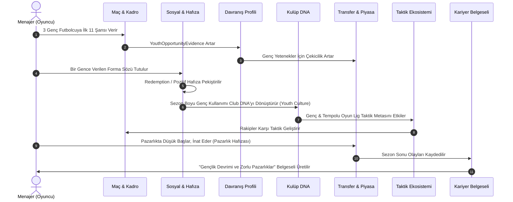

# Post-MVP Sistemik İnovasyon Programı (Post-MVP Innovation Program)

**Belge:** `docs/20_POST_MVP_INNOVATION_PROGRAM.md`  
**Durum:** Kesinleşti — Yaşayan Mimari ve Tasarım Yol Haritası  
**Ana Referans:** `docs/01_GAME_DESIGN_DOCUMENT.md`  
**Proje Endeksi:** `docs/00_PROJECT_INDEX.md`  
**Mevcut Üretim Planı:** `docs/19_PRODUCTION_IMPLEMENTATION_PLAN.md`  
**Karar Günlüğü:** `docs/15_DECISION_LOG.md` (D-412–D-415 ve sonrası)  

---

## 1. Amaç

Bu belge, Football Career Simulator projesinde MVP kabulü tamamlanmış olan 14 bounded context mimarisini koruyarak, oyun dünyasını yaşayan, öğrenen, eksik ve sosyal bilgi yayan, kurumsal ve taktik hafıza geliştiren ve bütün bunların arkasındaki nedenselliği oyuncuya açıklayabilen 10 sistemik yenilikten oluşan **Post-MVP Innovation Programı**'nın yetkili (authoritative) tasarım, mimari sözleşme ve implementasyon yol haritasıdır.

Bu programın temel felsefesi:
> **Oyuncunun kararlarını yalnızca hatırlayan değil, bu kararlardan beklenti oluşturan; bilgiyi eksik ve sosyal biçimde yayan; taktik, kurum ve insanları yıllar içinde dönüştüren; geçmiş çatışmaların yeniden anlam kazanabildiği ve bütün bu dinamiklerin nedenlerini oyuncuya açıklayabilen bir futbol evreni inşa etmektir.**

Bu belge, yüzeysel bir fikir listesi veya taslak beyin fırtınası değil; her biri bağımsız olarak doğrulanabilir, deterministik, geri alınabilir ve mevcut 10 sezonluk simülasyon bütünlüğünü koruyan dikey kesitlerin teknik tasarım şartnamesidir.

---

## 2. Mevcut Production Baseline

Bu program hazırlanırken doğrulanan teknik ve mimari zemin:

1. **Aktif Sürüm Kontrolü**:
   - Branch: `docs/production-implementation-plan`
   - Doğrulanan HEAD: `a0d94b941b2060a542968f7634df292647427d45`
   - Çalışma ağacındaki mevcut kullanıcı geliştirmeleri (ör. `ContinentalTournamentDigest`, `ScoutTransferDigest`, `EuropeanElite202627DataPack`) korunmaktadır.
2. **Teknoloji Yığını**:
   - Çalışma Zamanı / Dil: .NET 9 (`net9.0`), C# 13
   - Presentation: Godot 4.7-stable (mono/.NET), saf C# köprüsü
   - Kalıcılık (Persistence): `Microsoft.Data.Sqlite 10.0.9`, atomik temp-swap, canonical SHA-256 hash doğrulamalı
   - Aktif Kayıt Şeması: Career V49 (`ProductionWorldCalendarSaveSchema.CurrentVersion = 49`)
3. **Kalite ve Test Kapısı**:
   - Hızlı testler (`Category!=LongRunning`): **1034 / 1034 yeşil** (0 hata, 0 atlama).
   - LongRunning testi: `ProductionTenSeasonAcceptanceTests` (18 kulüp, 450 oyuncu, 10 sezon, 3.060 fikstür, ara save/load döngüsü).
4. **Kod Tabanı Yapısı**:
   - `FootballCareerSimulator.Domain`: 14 bounded context (saf domain aggregates, entities, value objects, domain events, domain exceptions).
   - `FootballCareerSimulator.Simulation`: Sezon, maç, fikstür, zaman ilerletme ve tohumlanmış deterministik simülasyon motorları.
   - `FootballCareerSimulator.Application`: Use case handlers, query services, digest projections, event-rule evaluation koordinasyonu, bounded context portları.
   - `FootballCareerSimulator.Infrastructure`: SQLite persistence, schema migrators, file system adapters.
   - `FootballCareerSimulator.Presentation`: Godot UI denetleyicileri, ekranlar, progressive disclosure yüzeyleri.

---

## 3. Kapsam ve Non-Goals

### 3.1. Kapsam (In-Scope)
Aşağıda listelenen 10 sistemik yeniliğin mimari tasarımı, veri modelleri, olay sözleşmeleri, kalıcılık stratejileri ve fazlandırılmış implementasyon kartları:
1. **Causality Foundation** ("Bu Neden Oldu? / Causality Journal")
2. **Behavioral Reputation** ("Dünya Seni Öğreniyor")
3. **Truth / Claim / Belief / Rumor** (Epistemik Bilgi Ayrımı)
4. **Dynamic Tactical Ecosystem** (Dinamik Taktik Ekosistemi)
5. **Club DNA / Institutional Memory** (Kurumsal Hafıza)
6. **Social Contagion** (Dressing Room Influence / Sosyal Bulaşma)
7. **Redemption / Resolution Memory** (Yeniden Anlamlandırma Hafızası)
8. **Coaching Lineage** (Futbol Soy Ağacı / Nesiller Arası Geçiş)
9. **Transfer Negotiation Behavioral Memory** (Pazarlık Belleği)
10. **Career Chronicle** (Deterministik Kariyer Belgeseli)

### 3.2. Kapsam Dışı (Non-Goals)
- **Mevcut MVP Sözleşmesini Sessizce Değiştirmek**: `docs/02_MVP_SCOPE.md` değişmez. Bu program bir Post-MVP genişlemesidir.
- **Full Event Sourcing'e Geçiş**: Mevcut snapshot-first mimari korunacaktır. Olaylar iş kurallarının işletilmesinde ve nedensellik projeksiyonlarında kullanılır; aggregate durumunun tek kaynağı snapshot'tır.
- **Zorunlu Generative AI / LLM Bağımlılığı**: Çekirdek simülasyon, kurallar, kararlar ve sonuçlar %100 yerel ve deterministiktir. LLM yalnızca gelecekte opsiyonel bir sunum/metin süsleme aracı olabilir; simülasyon girdisi veya kural motoru olamaz.
- **Kontrolsüz $O(N^2)$ Sosyal Graf**: Tüm oyuncuların birbirini takip ettiği yoğun (dense) matrisler yasaktır. Yalnızca sparse (seyrek) ve anlamlı bağlar (kaptan, mentor, aynı mevki/yaş grubu) modellenecektir.
- **Tanrısal Bilgi (Cheating AI)**: AI aktörlerin diğer aktörlerin gizli özelliklerini, özel görüşmelerini veya iç yönetim eşiklerini doğrudan okuması kesinlikle yasaktır.
- **Karmaşık UI Dashboard'ları**: Godot Career Hub bir Excel paneline dönüştürülmeyecektir; "Sıradaki Adım" ve progressive disclosure felsefesi korunacaktır.

---

## 4. Architecture Invariants (Mimari Değişmezler)

1. **14 Bounded Context İhlal Edilemez**: Yeni bir bounded context açılmayacaktır. Tüm sistemler mevcut context'lerin içine dağıtılacaktır.
2. **Foreign State Mutation Yasağı**: Hiçbir context diğer context'in aggregate state'ini doğrudan değiştiremez. Etkiler Domain Event -> Application Orchestrator -> Target Context Command zinciriyle gerçekleşir.
3. **Determinizm Kuralı**: `Aynı Seed + Aynı Girdi Sırası + Aynı Model/Kural Sürümü = Birebir Aynı Semantik Çıktı ve Hash`. `Random.Shared`, `DateTime.Now`, sırasız sözlük iterasyonu (`Dictionary<K,V>` üzerinden `foreach`), ve unseeded `Guid.NewGuid()` kullanımı kesinlikle yasaktır.
4. **Idempotency Zorunluluğu**: Bir event handler veya reaction iki kez tetiklendiğinde ikinci çağrı semantik bir değişiklik veya mükerrer veri üretmemelidir (`EventEffectIdempotencyGate` kullanımı).
5. **Geriye Dönük Kayıt Uyumluluğu (Backward Compatibility)**: Yeni save alanları atomik SQLite migration'ları üzerinden V50, V51 şeklinde sürümlenecektir. Eski kayıtlar `.bak` yedeği ile korunarak bozulmadan taşınmalıdır.
6. **Veri Büyümesi Sınırı (Bounded Retention)**: 10 sezon boyunca biriken evidence, fact veya rumor kayıtları sınırsız büyüyemez; aktif pencere (sliding window), sıkıştırma (compaction) ve özetleme (aggregation) uygulanacaktır.

---

## 5. Innovation Context Map (Bağlam Sahiplik Matrisi)

| İnovasyon | Authoritative Owner | Destekleyen / Etkilenen Context'ler | Read Model / Projeksiyon |
|---|---|---|---|
| **1. Causality Foundation** | `EventRuleEvaluation` | Tümü (Social, Transfer, Manager, Club, Match) | `CausalityExplanation`, `CausalityDiagnosticTrace` |
| **2. Behavioral Reputation** | `ManagerCareer` | `EventRuleEvaluation`, `Interaction`, `SocialContinuity`, `Transfer` | `ManagerBehavioralProfileReadModel` |
| **3. Truth / Claim / Belief** | `Interaction` & `SocialContinuity` | `Transfer`, `ManagerCareer`, `ClubGovernance` | `ActorBeliefDigest`, `PublicRumorDigest` |
| **4. Tactical Ecology** | `Match` & `TeamPreparation` | `Competition`, `ManagerCareer` | `LeagueTacticalTrendReadModel` |
| **5. Club DNA** | `ClubGovernance` | `ManagerCareer`, `ContractRegistration`, `PlayerCareer` | `ClubDnaProfileDigest` |
| **6. Social Contagion** | `SocialContinuity` | `Interaction`, `TeamPreparation` | `DressingRoomSocialClimateDigest` |
| **7. Redemption Memory** | `SocialContinuity` | `Interaction`, `EventRuleEvaluation` | `MemoryResolutionDigest` |
| **8. Coaching Lineage** | `ManagerCareer` & `PlayerCareer` | `ClubGovernance`, `SocialContinuity` | `CoachingLineageTreeDigest` |
| **9. Negotiation Memory** | `Transfer` | `ManagerCareer`, `Interaction` | `NegotiationTacticDossierDigest` |
| **10. Career Chronicle** | `Interaction` (Presentation Projection) | Tümü (World, Competition, Club, Manager, Player) | `SeasonChronicleDigest`, `CareerRetrospective` |

---

## 6. YENİLİK 1 — Causality Foundation ("Bu Neden Oldu? / Causality Journal")

### 6.1. Amaç
Oyuncunun ve simülasyonun karşılaştığı kritik sonuçların (güven düşüşü, söz bozulması, transfer reddi, yönetim ültimatomu, maç sonucu vb.) "neden" gerçekleştiğini gerçek domain olay zincirine dayanarak açıklayan evrensel nedensellik katmanını kurmak.

### 6.2. Oyuncuya Sağladığı Değer
Oyun asla bir "kara kutu" hissi vermez. Oyuncu haksız veya rastgele cezalandırıldığını düşünmez; geçmiş eylemlerinin, verdiği kararların ve çevresel faktörlerin somut etkilerini görerek stratejik derinlik kazanır.

### 6.3. Authoritative Owner
`EventRuleEvaluation` (Causality Graph Projeksiyonu).

### 6.4. Kullandığı Authoritative Veriler
- `EventEnvelopeMetadata` (`EventId`, `CorrelationId`, `CausationId`, `SourceContext`, `OccurredAtDayNumber`)
- `ReactionIntent` (`RuleId`, `SourceEventId`, `IntentTypeCode`)
- `Promise` durumu (`PromiseStatus`, `TerminalOn`)
- `MemoryRecord` (`Category`, `CurrentInfluence`, `Valence`)
- `RelationshipRecord` (`Trust`, `Respect`, `ProfessionalCompatibility`)
- `ClubEmployment` / `BoardConfidence` değerlendirme neden kodları.

### 6.5. Derived Veriler
- Causal Factor ağırlıkları (`PrimaryFactor`, `ContributingFactors`, `MitigatingFactors`).
- Anlatısal açıklama şablonları (Semantic text keys).

### 6.6. Etkilediği Bounded Context'ler
Doğrudan hiçbir context'in authoritative state'ini mutasyona uğratmaz. Presentation ve Application digest katmanlarını besler.

### 6.7. Etkilendiği Bounded Context'ler
Tüm 14 bounded context (oluşturdukları domain olayları ve kural tetikleyicileri üzerinden).

### 6.8. Command Kategorileri
- `RecordCausalLinkCommand` (İç altyapı/projeksiyon komutu).

### 6.9. Domain Event Kategorileri
- `CausalityAttributedEvent` (Opsiyonel teşhis olayı).

### 6.10. Integration Event Kategorileri
- Yok (Authoritative state dışı okuma modeli).

### 6.11. Tepki Verdiği Event'ler
- `RelationshipEvaluatedEvent`
- `PromiseBrokenEvent` / `PromiseFulfilledEvent`
- `TransferProcessTerminatedEvent`
- `BoardAssessmentCompletedEvent`
- `MatchPlayedEvent`

### 6.12. Ürettiği Projection/Read Model'ler
- `CausalityExplanation`: Oyuncu yüzüne yönelik semantik açıklama (Primary Cause, Supporting Factors, Mitigating Factors, Historical Context).
- `CausalityDiagnosticTrace`: Geliştirici ve test doğrulaması için tam Rule ID ve Correlation ID izleme kaydı.

### 6.13. Persistence Gereksinimi
Kritik kariyer olaylarının nedensellik bağları SQLite'ta `CausalityLog` tablosunda saklanır.

### 6.14. Save Migration Gereksinimi
V50 şemasına `CausalityLog` tablosu eklenir.

### 6.15. Determinism Gereksinimi
Aynı olay ve kural girdisi her zaman aynı neden hiyerarşisini ve aynı metin anahtarlarını üretmelidir.

### 6.16. Idempotency Gereksinimi
Aynı `EventId` için birden fazla nedensellik kaydı oluşturulamaz (`CausalityKey = TargetEventId`).

### 6.17. Data Growth / Retention Politikası
Aktif sezonda tüm nedensellikler tutulur. Sezon sonunda önemsiz (`Importance < Threshold`) olayların detayları sıkıştırılır; yalnızca majör kariyer dönüm noktalarının nedenselliği kalıcı arşivde saklanır.

### 6.18. UI / Presentation İhtiyacı
Karar Masası, İlişki Ekranı, Maç Sonucu ve Transfer sayfasında küçük ve şık bir "Neden?" butonu veya genişletilebilir panel (Accordion/Popover).

### 6.19. Edge Case'ler
- Nedensellik zinciri eksik/kayıp olan eski save olayları: "Tarihsel koşullar ve genel performans faktörleri" fallback metni.
- Eşit ağırlığa sahip birden fazla birincil neden: Deterministik kural ID ve tarih sıralamasıyla seçim.

### 6.20. Unit Test'ler
- `CausalityRecordTests`: Faktör ekleme, ağırlıklandırma, geçerlilik doğrulaması.
- `CausalityExplanationBuilderTests`: Ham veriden semantik nesneye deterministik dönüşüm.

### 6.21. Integration Test'ler
- `RelationshipCausalityIntegrationTests`: Bir forma sözü bozulduğunda ve güven düştüğünde doğru "Neden?" kaydının oluştuğunun testi.

### 6.22. Save/Load Test'leri
- Nedensellik kayıtlarının kaydedilip hatasız geri yüklenmesi ve hash bütünlüğünün korunması.

### 6.23. 10 Sezonluk Long-Running Test'ler
- 10 sezon boyunca nedensellik tablosunun bellek sızıntısı ve aşırı dosya boyutu üretmediğinin (`Compaction` çalışmasının) doğrulanması.

### 6.24. MVP Dışı Bırakılan Ayrıntılar & Açık Kararlar
- Ayrıntılı grafik görselleştirmesi (Node-edge görsel UI) MVP dışıdır; metinsel hiyerarşi esastır.
- Açık Karar D-414: Causality tablosunun sliding-window boyutu (Maksimum 500 aktif kayıt).

---

## 7. YENİLİK 2 — Behavioral Reputation ("Dünya Seni Öğreniyor")

### 7.1. Amaç
Teknik direktörün yıllar içindeki eylemlerinden bağımsız kanıtlar (behavioral evidence) toplayarak, yapay zekanın ve futbolcuların menajer hakkındaki beklentilerini şekillendiren dinamik bir itibar profili oluşturmak.

### 7.2. Oyuncuya Sağladığı Değer
Oyuncu "tek tip genel itibar puanı" yerine, kendi tarzına sahip bir menajer olur. Örneğin "Gençlere şans veren", "Sözünün eri", "Pazarlıkta inatçı" veya "Krizde oyuncusunu basına yem eden" gibi gerçek bir kimlik kazanır.

### 7.3. Authoritative Owner
`ManagerCareer`.

### 7.4. Kullandığı Authoritative Veriler
- `MatchSelection` (İlk 11'e giren oyuncuların yaşları, altyapı statüleri).
- `Promise` geçmişi (Verilen, tutulan, bozulan söz sayıları ve oranları).
- `DialogueSession` / `DecisionRequest` cevapları (Basın toplantısı ve kriz cevap tarzları).
- `TransferProcess` teklif geçmişi (Teklif sayısı, revizyon sıklığı, deadline hareketleri).

### 7.5. Derived Veriler
- `ManagerBehavioralProfile`:
  - `PromiseReliabilityEvidence` (0–100)
  - `YouthOpportunityEvidence` (0–100)
  - `PublicSupportEvidence` (0–100)
  - `NegotiationPersistenceEvidence` (0–100)
  - `RotationConsistencyEvidence` (0–100)
  - `TacticalRigidityEvidence` (0–100)

### 7.6. Etkilediği Bounded Context'ler
- `Interaction`: Diyalog seçeneklerinin inandırıcılığı.
- `Transfer`: Genç oyuncuların kulübe gelme isteği, satıcı kulüplerin tavrı.
- `ClubGovernance`: Yönetim kurulu iş teklifleri ve beklentileri.
- `SocialContinuity`: Oyuncu güven başlangıç seviyeleri.

### 7.7. Etkilendiği Bounded Context'ler
- `Match`, `TeamPreparation`, `Interaction`, `Transfer`, `SocialContinuity`.

### 7.8. Command Kategorileri
- `RegisterBehavioralObservationCommand`
- `RecomputeBehavioralProfileCommand`

### 7.9. Domain Event Kategorileri
- `BehavioralEvidenceObservedEvent`
- `ManagerBehavioralProfileUpdatedEvent`

### 7.10. Integration Event Kategorileri
- `ManagerBehavioralTraitsChangedIntegrationEvent`

### 7.11. Tepki Verdiği Event'ler
- `MatchPlayedEvent`
- `PromiseEvaluatedEvent`
- `DecisionAnsweredEvent`
- `TransferCompletedEvent` / `TransferCancelledEvent`

### 7.12. Ürettiği Projection/Read Model'ler
- `ManagerBehavioralDigest`: Menajer profilinde oyuncunun görebileceği özet nitelikler ve kanıtlar.

### 7.13. Persistence Gereksinimi
`ManagerBehavioralProfile` ve son N gözlem SQLite'ta `ManagerBehavioralEvidence` tablosunda saklanır.

### 7.14. Save Migration Gereksinimi
V50 şemasına davranış kanıtı tablosu eklenir.

### 7.15. Determinism Gereksinimi
Aynı olay geçmişi her zaman tam olarak aynı davranış katsayılarını üretmelidir.

### 7.16. Idempotency Gereksinimi
Aynı maç veya diyalog kararı ikinci kez davranış kanıtı olarak kaydedilemez.

### 7.17. Data Growth / Retention Politikası
Ham gözlemler son 2 sezon ile sınırlıdır; eski sezonlar kümülatif ağırlıklı ortalamaya (exponential moving average) sıkıştırılır.

### 7.18. UI / Presentation İhtiyacı
Menajer Profil ekranında "Davranış Tarzı" ve "Dünyanın Gözündeki İtibarın" kartı.

### 7.19. Edge Case'ler
- Yeni başlayan kariyer (yeterli gözlem yok): "Henüz kanıtlanmamış / Gözlemleniyor" başlangıç bandı; nötr AI tepkisi.
- Radikal taktik/davranış değişikliği: Yeni kanıtların ağırlığının kademeli olarak profili güncellemesi.

### 7.20. Unit Test'ler
- `BehavioralEvidenceAggregatorTests`: Genç oyuncu süresi ve söz güvenilirliği formüllerinin doğrulanması.

### 7.21. Integration Test'ler
- `YouthPromiseTransferReactionTests`: Genç oynatma kanıtı yüksek olan menajere 18 yaşındaki yıldız adayının daha kolay imza atması.

### 7.22. Save/Load Test'leri
- Davranış profili ve kümülatif kanıtların round-trip doğrulaması.

### 7.23. 10 Sezonluk Long-Running Test'ler
- 10 sezon boyunca kanıt havuzunun şişmeden EMA ile düzgün sıkıştığının kontrolü.

### 7.24. MVP Dışı Bırakılan Ayrıntılar & Açık Kararlar
- Gizli bir "iyi/kötü menajer" skoru oluşturulmayacaktır; her boyut iki ucu da geçerli bir tarz kanıtıdır.

---

## 8. YENİLİK 3 — Truth / Claim / Belief / Rumor (Epistemik Bilgi Ayrımı)

### 8.1. Amaç
Futbol dünyasındaki nesnel gerçeklik (Truth) ile aktörlerin iddiaları (Claim), inançları (Belief) ve dedikoduları (Rumor) arasındaki farkı modelleyerek asimetrik ve organik bir sosyal bilgi akışı sağlamak.

### 8.2. Oyuncuya Sağladığı Değer
Herkes her şeyi anında ve doğru biçimde bilmez. Basındaki bir haber yalan veya abartı olabilir; bir futbolcu menajerinin iddiaları gerçek durumu yansıtmayabilir; soyunma odasında kulaktan kulağa yayılan söylentiler yönetilebilir veya patlayabilir.

### 8.3. Authoritative Owner
- Gerçek (Truth): Orijinal kaynak bounded context (`Transfer`, `Interaction`, `SocialContinuity` vb.).
- İddia/İnanç/Dedikodu (Claim/Belief/Rumor): `Interaction` & `SocialContinuity`.

### 8.4. Kullandığı Authoritative Veriler
- Orijinal domain fact'leri (`EventEnvelopeMetadata`, `Promise`, `TransferProcess`).
- Aktör ilişkileri ve sosyal ağ bağları (`ActorRef`, `RelationshipRecord`).

### 8.5. Derived Veriler
- `ClaimRecord` (`Subject`, `ClaimantActor`, `ContentCode`, `Credibility`, `PublicityLevel`).
- `ActorBeliefRecord` (`ObserverActor`, `SubjectKey`, `BelievedClaimId`, `ConfidenceLevel`).
- `RumorRecord` (`SourceContext`, `SpreadDepth`, `TaintedFlag`).

### 8.6. Etkilediği Bounded Context'ler
- `Interaction`: Medya soruları, diyalog alternatifleri.
- `SocialContinuity`: Aktörün diğer aktör hakkındaki tutumu.
- `Transfer`: Oyuncunun kulüpten ayrılma isteği.

### 8.7. Etkilendiği Bounded Context'ler
- `Transfer`, `Interaction`, `SocialContinuity`, `ClubGovernance`.

### 8.8. Command Kategorileri
- `PublishClaimCommand`
- `PropagateRumorCommand`
- `FormActorBeliefCommand`

### 8.9. Domain Event Kategorileri
- `ClaimPublishedEvent`
- `RumorSpreadEvent`
- `BeliefFormedEvent`

### 8.10. Integration Event Kategorileri
- `PublicNarrativeShiftedIntegrationEvent`

### 8.11. Tepki Verdiği Event'ler
- `PrivateDiscussionConcludedEvent`
- `TransferBidRejectedEvent`
- `ContractNegotiationStalledEvent`

### 8.12. Ürettiği Projection/Read Model'ler
- `MediaStoryDigest`: Basında yer alan haberlerin doğruluk/söylenti etiketleri ("İddia", "Kulüp Kaynakları", "Doğrulandı").
- `LockerRoomRumorDigest`: Soyunma odasında konuşulan dedikodular.

### 8.13. Persistence Gereksinimi
Aktif söylentiler ve aktör inançları SQLite'ta `ActorBeliefs` ve `ActiveRumors` tablolarında tutulur.

### 8.14. Save Migration Gereksinimi
V51 şemasına dedikodu ve inanç tabloları eklenir.

### 8.15. Determinism Gereksinimi
Dedikodunun yayılımı ve inanç oluşumu tohumlanmış `SimulationRandomContext` ile belirlenir.

### 8.16. Idempotency Gereksinimi
Bir aktör aynı iddia için birden fazla inanç üretemez; aynı iddia bir aktöre iki kez yayılamaz.

### 8.17. Data Growth / Retention Politikası
Dedikoduların yaşam döngüsü vadesi (TTL) 14–30 oyun günüdür. Vadesi dolan dedikodular ve çözümlenmiş inançlar silinir.

### 8.18. UI / Presentation İhtiyacı
Haber akışında güvenilirlik rozetleri ("Doğrulandı", "Söylenti", "Yalanlandı").

### 8.19. Edge Case'ler
- Gerçek ortaya çıktığında (Truth revealed): Yalan iddialara inanan aktörlerin hayal kırıklığı yaşaması ve güven kaybetmesi.

### 8.20. Unit Test'ler
- `EpistemicBoundaryTests`: Özel bir görüşmenin sızdırılmadığı sürece üçüncü şahıslar tarafından inanç oluşturamadığının testi.

### 8.21. Integration Test'ler
- `TransferRumorMoraleIntegrationTests`: Basında çıkan transfer dedikodusunun oyuncunun moralini ve takım içi inançları etkilemesi.

### 8.22. Save/Load Test'leri
- Aktif dedikodu ve inançların save/load sonrası süre ve durumlarını koruması.

### 8.23. 10 Sezonluk Long-Running Test'ler
- Dedikoduların temizlenme mekanizmasının (TTL) 10 sezon boyunca tabloyu sabit boyutta tuttuğunun kanıtı.

### 8.24. MVP Dışı Bırakılan Ayrıntılar & Açık Kararlar
- Tam medya simülasyonu (gazeteciler, televizyon programları) yapılmaz; haber akışı digest düzeyinde kalır.

---

## 9. YENİLİK 4 — Dynamic Tactical Ecosystem (Dinamik Taktik Ekosistemi)

### 9.1. Amaç
Ligdeki taktiksel anlayışların statik kalmasını engelleyerek, başarılı yaklaşımların AI menajerler tarafından benimsendiği ve buna karşılık antitez taktiklerin geliştiği dinamik bir ekosistem kurmak.

### 9.2. Oyuncuya Sağladığı Değer
Oyuncu 5 sezon boyunca aynı taktikle namağlup şampiyon olamaz; lig rakipleri onun veya lig liderinin oyun planını analiz eder, zayıf yönlerine odaklanır ve lige taktiksel trendler hakim olur.

### 9.3. Authoritative Owner
`Match` ve `TeamPreparation`.

### 9.4. Kullandığı Authoritative Veriler
- `Fixture` maç sonuçları ve istatistikleri (`MatchScore`, `MatchKeyMoments`).
- Oynanan maçlardaki formasyonlar ve taktiksel yaklaşımlar (`Formation`, `TacticalApproach`, `TacticPlan`).
- Menajer taktiksel esneklik/tercih verileri.

### 9.5. Derived Veriler
- `LeagueTacticalMetaSnapshot`:
  - En popüler formasyonlar ve başarı oranları.
  - Yüksek pres / düşük blok başarı eğilimleri.
  - Karşı taktiksel başarı katsayıları (Counter-tactic efficacy).

### 9.6. Etkilediği Bounded Context'ler
- `TeamPreparation`: AI rakip maç hazırlığı ve taktik seçimi.
- `Transfer`: Belirli taktiklere uygun mevkilere lig genelinde artan/azalan talep.

### 9.7. Etkilendiği Bounded Context'ler
- `Match`, `Competition`, `ManagerCareer`.

### 9.8. Command Kategorileri
- `AnalyzeLeagueTacticalMetaCommand`
- `AdaptAiTacticalPlanCommand`

### 9.9. Domain Event Kategorileri
- `TacticalMetaShiftedEvent`
- `TacticalCounterAdoptedEvent`

### 9.10. Integration Event Kategorileri
- `LeagueTacticalEcosystemUpdatedIntegrationEvent`

### 9.11. Tepki Verdiği Event'ler
- `SeasonFirstHalfCompletedEvent`
- `SeasonCompletedEvent`
- `MatchPlayedEvent`

### 9.12. Ürettiği Projection/Read Model'ler
- `TacticalIntelligenceDigest`: Rakip analizinde "Rakibin lig trendine göre uyarladığı plan" ve "Ligde yükselen taktik dalga" okuma modeli.

### 9.13. Persistence Gereksinimi
Sezonluk lig taktik meta özeti `LeagueTacticalMetaHistory` tablosunda saklanır.

### 9.14. Save Migration Gereksinimi
V52 şemasına taktik ekosistem tablosu eklenir.

### 9.15. Determinism Gereksinimi
Meta analizi ve AI benimseme kararları tohumlanmış RNG ve sabit sıralama algoritmalarıyla çalışır.

### 9.16. Idempotency Gereksinimi
Bir sezonluk analiz aynı gün veya aşamada iki kez çalıştırıldığında aynı meta kaydı güncellenir.

### 9.17. Data Growth / Retention Politikası
Yalnızca son 3 sezonun taktiksel meta kayıtları saklanır; eski sezonlar silinir veya tek satırlık özete dönüştürülür.

### 9.18. UI / Presentation İhtiyacı
Maç Öncesi Hazırlık ve Analiz ekranında "Lig Trendi & Taktiksel İstihbarat" paneli.

### 9.19. Edge Case'ler
- Hiçbir taktiğin açık ara üstün olmadığı dengeli ligler: AI menajerlerin kendi geleneksel formasyonlarında kalması.

### 9.20. Unit Test'ler
- `TacticalMetaEvaluationTests`: Başarılı yüksek pres sonuçlarının lig popülarite puanını artırdığının testi.

### 9.21. Integration Test'ler
- `AiTacticalAdaptationIntegrationTests`: Oyuncunun şampiyon taktiğine karşı sonraki sezon rakiplerin antitez taktik seçme sıklığının arttığının doğrulanması.

### 9.22. Save/Load Test'leri
- Taktik meta verilerinin ve AI adaptasyon durumlarının save/load döngüsünde korunması.

### 9.23. 10 Sezonluk Long-Running Test'ler
- 10 sezon boyunca lig formasyon dağılımlarının tek bir uç noktaya (ör. %100 4-4-2) kilitlenmediğinin ve dinamik dalgalanmanın sürdüğünün doğrulanması.

### 9.24. MVP Dışı Bırakılan Ayrıntılar & Açık Kararlar
- Kaba global kural modifier'ları ("2028: pres +10 puan") kesinlikle kullanılmaz; tüm etki simülasyondan türetilir.

---

## 10. YENİLİK 5 — Club DNA / Kurumsal Hafıza

### 10.1. Amaç
Kulüpleri salt bütçe ve güç değerlerinden çıkarıp, yıllar boyunca alınan kararlarla oluşan gerçek bir kurumsal kimliğe (Club DNA / Institutional Memory) kavuşturmak.

### 10.2. Oyuncuya Sağladığı Değer
Farklı kulüpleri çalıştırmak tamamen farklı hissettirir. Ajax gibi bir kulüpte genç oynatmak kulüp kültürü gereğiyken, bir işçi takımı veya satıcı kulüpte beklentiler ve yönetim toleransı buna göre şekillenir.

### 10.3. Authoritative Owner
`ClubGovernance`.

### 10.4. Kullandığı Authoritative Veriler
- Kulübün tarihi transferleri (yaş ortalaması, bonservis harcama/kazanç dengesi).
- Kulübün akademiden A takıma oyuncu kazandırma oranı.
- Menajer görev süreleri (tenure) ve görevden alma sıklığı.
- Tarihsel taktik ve futbol tarzı tercihleri.

### 10.5. Derived Veriler
- `ClubDnaProfile`:
  - `YouthDevelopmentCulture` (0–100)
  - `RecruitmentAggression` (0–100)
  - `SellingClubTendency` (0–100)
  - `ManagerialPatience` (0–100)
  - `WageDiscipline` (0–100)
  - `HighIntensityTradition` (0–100)

### 10.6. Etkilediği Bounded Context'ler
- `ManagerCareer`: Yönetim kurulu beklentileri, menajer değerlendirmesi ve kovulma eşikleri.
- `Transfer`: Kulübün transfer komitesinin ve scout önerilerinin öncelikleri.
- `Interaction`: Yönetim talepleri ve kriz başlıkları.

### 10.7. Etkilendiği Bounded Context'ler
- `Match`, `Transfer`, `PlayerCareer`, `ClubGovernance`.

### 10.8. Command Kategorileri
- `UpdateClubDnaProfileCommand`
- `RecordInstitutionalPolicyDecisionCommand`

### 10.9. Domain Event Kategorileri
- `ClubDnaCultureShiftedEvent`
- `InstitutionalPolicyViolatedEvent`

### 10.10. Integration Event Kategorileri
- `ClubInstitutionalIdentityUpdatedIntegrationEvent`

### 10.11. Tepki Verdiği Event'ler
- `SeasonCompletedEvent`
- `TransferCompletedEvent`
- `ManagerDismissedEvent` / `ManagerHiredEvent`

### 10.12. Ürettiği Projection/Read Model'ler
- `ClubCultureDigest`: Kulüp ekranında "Kulüp DNA'sı ve Gelenekleri" okuma modeli (2–4 belirgin kültürel kimlik rozeti).

### 10.13. Persistence Gereksinimi
Her kulüp için `ClubDnaState` SQLite'ta `ClubDnaProfiles` tablosunda saklanır.

### 10.14. Save Migration Gereksinimi
V52 şemasına kulüp DNA profilleri tablosu eklenir; başlangıç verileri mevcut veri paketinden türetilir.

### 10.15. Determinism Gereksinimi
DNA güncellemeleri sezon sonu committed fact'lerin deterministik ağırlıklı ortalamasıyla hesaplanır.

### 10.16. Idempotency Gereksinimi
Aynı sezon için DNA güncellemesi yalnızca bir kez işlenebilir.

### 10.17. Data Growth / Retention Politikası
Her kulüp için tek bir aktif DNA profili bulunur ($O(Clubs)$); geçmiş sezon değişimleri en fazla son 5 sezon için delta olarak tutulur.

### 10.18. UI / Presentation İhtiyacı
Kulüp Genel Bakış ekranında "Kurumsal Kültür" kartı ve yönetim beklenti rozetleri.

### 10.19. Edge Case'ler
- Yeni menajerin kulüp DNA'sına tamamen zıt davranması (ör. Genç kulübüne 35 yaşında 5 transfer yapması): Yönetim memnuniyetsizliği ve kurumsal direnç ("Kültür Çatışması" olayı).

### 10.20. Unit Test'ler
- `ClubDnaCalculationTests`: 3 sezon genç ağırlıklı oynayan kulübün `YouthDevelopmentCulture` puanının yükseldiğinin doğrulanması.

### 10.21. Integration Test'ler
- `ClubDnaManagerConflictIntegrationTests`: Kulüp DNA'sı ile çatışan menajer kararlarının yönetim güvenini negatif etkilediğinin testi.

### 10.22. Save/Load Test'leri
- Menajer ayrılıp başka kulübe geçtiğinde eski kulübün DNA'sının korunduğunun doğrulanması.

### 10.23. 10 Sezonluk Long-Running Test'ler
- 10 sezon boyunca kulüp kimliklerinin aşırı homojenleşmediğinin ve ayırt edici özelliklerini koruduğunun kanıtı.

### 10.24. MVP Dışı Bırakılan Ayrıntılar & Açık Kararlar
- Kulüp başkanı seçimleri veya tüzük değişiklikleri MVP dışıdır.

---

## 11. YENİLİK 6 — Social Contagion (Dressing Room Influence / Sosyal Bulaşma)

### 11.1. Amaç
Takım içindeki duygusal ve ilişkisel dalgalanmaların (örneğin kaptanın menajere güvenini kaybetmesi) soyunma odasında sınırlı, açıklanabilir ve seyrek (sparse) bağlar üzerinden yayılabilmesini sağlamak.

### 11.2. Oyuncuya Sağladığı Değer
Lider bir oyuncuyla girilen çatışma yalnız o oyuncuyla sınırlı kalmaz; takımın soyunma odası hiyerarşisi gerçek bir dinamik kazanır. Menajer takımdaki nüfuz odaklarını gözetmek zorunda kalır.

### 11.3. Authoritative Owner
`SocialContinuity`.

### 11.4. Kullandığı Authoritative Veriler
- `RelationshipRecord` (Oyuncu-Menajer ve Oyuncu-Oyuncu güven/saygı seviyeleri).
- Kadro statüleri (Kaptan, İkinci Kaptan, Kıdemli Oyuncu, Genç Oyuncu).
- Takım içi paylaşılan bağlar (Aynı milliyet/dil, uzun süredir takım arkadaşı olma, aynı yaş grubu).

### 11.5. Derived Veriler
- `SparseInfluenceLink`: İki oyuncu arasındaki etkin sosyal köprü (Maksimum 3–5 aktif bağ/oyuncu).
- `DressingRoomAtmosphere`: Takım genelindeki duygu iklimi (Birleşik, Bölünmüş, İsyan Eşiğinde, Sakin).

### 11.6. Etkilediği Bounded Context'ler
- `Interaction`: Takım toplantısı ve grup tepkisi diyalogları.
- `TeamPreparation`: Takım uyumu ve maç günü motivasyon katsayısı.
- `SocialContinuity`: İkincil oyuncuların menajere olan güven deltasında dolaylı etki.

### 11.7. Etkilendiği Bounded Context'ler
- `Interaction`, `Match`, `SocialContinuity`.

### 11.8. Command Kategorileri
- `PropagateDressingRoomInfluenceCommand`
- `RefreshSocialInfluenceTiesCommand`

### 11.9. Domain Event Kategorileri
- `SocialContagionPropagatedEvent`
- `LockerRoomSplitDetectedEvent`

### 11.10. Integration Event Kategorileri
- `DressingRoomClimateChangedIntegrationEvent`

### 11.11. Tepki Verdiği Event'ler
- `MajorRelationshipShiftEvent` (Ör. Kaptanın güveninin Düşük banda düşmesi).
- `PlayerDisciplinedEvent`
- `PromiseBrokenEvent`

### 11.12. Ürettiği Projection/Read Model'ler
- `DressingRoomInfluenceDigest`: Soyunma odası liderleri ve takımın genel atmosferi ("Kaptan huzursuz — gençleri etkiliyor").

### 11.13. Persistence Gereksinimi
Aktif nüfuz bağları ve son dalgalanma zamanları SQLite'ta `SocialInfluenceLinks` tablosunda tutulur.

### 11.14. Save Migration Gereksinimi
V53 şemasına sosyal nüfuz tablosu eklenir.

### 11.15. Determinism Gereksinimi
Bulaşma yayılımı ve aktör tepkisi deterministik öncelik ve seed tabanlı kontrolle çalışır.

### 11.16. Idempotency Gereksinimi
Tek bir kriz olayı için bulaşma yalnızca 1 derinlikte (depth=1) yayılır ve cooldown süresi (en az 14 gün) boyunca aynı olay yeniden tetiklenemez.

### 11.17. Data Growth / Retention Politikası
Tam matris kesinlikle kurulmaz; oyuncu başına en fazla 4 sparse bağ saklanır ($O(Squad)$ sınırında kalır).

### 11.18. UI / Presentation İhtiyacı
Soyunma Odası ekranında "Sosyal Hiyerarşi & Etki Grupları" paneli.

### 11.19. Edge Case'ler
- Kaptanın takımda yalnız kalması (Düşük saygınlıkta kaptan): Bulaşmanın gerçekleşmemesi ve kaptanın tecrit olması.

### 11.20. Unit Test'ler
- `SparseInfluenceGraphTests`: Bulaşma derinliğinin 1 adımı aşmadığının ve $O(N)$ karmaşıklığında kaldığının testi.

### 11.21. Integration Test'ler
- `CaptainFalloutContagionTests`: Kaptanla yaşanan sert krizin, yakın takım arkadaşının güvenini %30 oranında etkilediğinin doğrulanması.

### 11.22. Save/Load Test'leri
- Sosyal etki bağlarının save/load sonrasında bütünlüğünü koruması.

### 11.23. 10 Sezonluk Long-Running Test'ler
- 10 sezon boyunca sosyal bağların patlama (event explosion) yapmadığının ve performans bütçesini aşmadığının kanıtı.

### 11.24. MVP Dışı Bırakılan Ayrıntılar & Açık Kararlar
- Oyuncu kliklerinin (klik savaşları) karmaşık mini-oyunu yapılmaz; sparse hiyerarşik bağlar esastır.

---

## 12. YENİLİK 7 — Redemption / Resolution Memory (Yeniden Anlamlandırma Hafızası)

### 12.1. Amaç
Hafıza (Memory) sistemini salt "zamanla azalan sayısal etki" modelinden çıkarıp; geçmişte yaşanan olumsuz veya gerilimli bir olayın, gelecekteki yeni eylemlerle "çözümlenebilmesini", "yeniden anlamlandırılabilmesini" veya "telafi edilebilmesini" sağlamak.

### 12.2. Oyuncuya Sağladığı Değer
Kırılan bir söz veya kesilen bir ceza ebedi bir düşmanlık olmak zorunda kalmaz. Yıllar sonra aynı oyuncuya kritik bir finalde güven verildiğinde "Geçmişte bana güvenmemişti ama bu kez arkamda durdu" şeklinde unutulmaz bir telafi hikayesi doğar.

### 12.3. Authoritative Owner
`SocialContinuity`.

### 12.4. Kullandığı Authoritative Veriler
- `MemoryRecord` (`MemoryId`, `Category`, `Status`, `Valence`, `CurrentInfluence`, `SourceEventKey`).
- İlişkili `Promise` ve `MatchSelection` olayları.

### 12.5. Derived Veriler
- `MemoryResolutionStatus`:
  - `Unresolved` (Varsayılan aktif durum)
  - `Reinforced` (Olumsuz tecrübenin tekrarı ile pekişmiş)
  - `Contradicted` (Zıt yönde olumlu bir davranışla sorgulanmış)
  - `PartiallyResolved` (Kısmen telafi edilmiş)
  - `Resolved` (Tamamen çözümlenmiş ve barışılmış)
  - `Reopened` (Çözümlenmiş bir yaranın yeni bir olayla tekrar açılması)

### 12.6. Etkilediği Bounded Context'ler
- `SocialContinuity`: İlişki değerlendirme kurallarında hafıza ağırlığının nötrlenmesi veya olumluya dönmesi.
- `Interaction`: Diyaloglarda geçmişe yapılan duygusal atıflar.

### 12.7. Etkilendiği Bounded Context'ler
- `Match`, `TeamPreparation`, `Interaction`, `SocialContinuity`.

### 12.8. Command Kategorileri
- `EvaluateMemoryResolutionCommand`
- `ResolveMemoryCommand`

### 12.9. Domain Event Kategorileri
- `MemoryResolutionStateChangedEvent`
- `MemoryRedeemedEvent`

### 12.10. Integration Event Kategorileri
- `ActorMemoryReinterpretedIntegrationEvent`

### 12.11. Tepki Verdiği Event'ler
- `MatchPlayedEvent` (Kritik maçta ilk 11 şansı).
- `PromiseFulfilledEvent`
- `DialogueSessionConcludedEvent` (Destekleyici özel görüşme).

### 12.12. Ürettiği Projection/Read Model'ler
- `MemoryNarrativeDigest`: Oyuncu dosyasında geçmiş olayların güncel durumu ("Kırık Forma Sözü — Kritik finalde forma verilerek telafi edildi").

### 12.13. Persistence Gereksinimi
`MemoryRecord` aggregate'ine `ResolutionStatus`, `ResolvedOn` ve `ResolutionReasonCode` alanları eklenir.

### 12.14. Save Migration Gereksinimi
V50/V51 şemasında `PlayerMemoryRecords` tablosuna kolon eklenir; eski kayıtlar `Unresolved` olarak varsayılır.

### 12.15. Determinism Gereksinimi
Telafi değerlendirmesi deterministik kural eşleşmeleriyle çalışır.

### 12.16. Idempotency Gereksinimi
Aynı telafi edici olay aynı hafıza için mükerrer çözülme tetikleyemez.

### 12.17. Data Growth / Retention Politikası
Çözümlenen (`Resolved`) hafızalar aktif etki üretmeyi bırakır (`CurrentInfluence = 0`), ancak kariyer belgeseli için hafif arşiv olarak saklanır.

### 12.18. UI / Presentation İhtiyacı
Futbolcu Detay -> İlişki ve Hafıza sekmesinde telafi edilmiş hafızaların yeşil/çözüldü ikonuyla gösterilmesi.

### 12.19. Edge Case'ler
- Telafi edilmiş bir oyuncuya bir sezon sonra tekrar söz kırılması: Hafızanın `Reopened` durumuna geçmesi ve çift kat etki üretmesi.

### 12.20. Unit Test'ler
- `MemoryResolutionLifecycleTests`: Unresolved -> Contradicted -> Resolved geçişlerinin testi.

### 12.21. Integration Test'ler
- `RedemptionToRelationshipIntegrationTests`: Telafi edilen hafızanın ardından oyuncu güveninin hızlı bir toparlanma eğrisine girdiğinin doğrulanması.

### 12.22. Save/Load Test'leri
- `ResolutionStatus` ve telafi verilerinin save/load round-trip doğrulaması.

### 12.23. 10 Sezonluk Long-Running Test'ler
- 10 sezon boyunca telafi edilen hafızaların aktif hafıza sınırını şişirmediğinin kontrolü.

### 12.24. MVP Dışı Bırakılan Ayrıntılar & Açık Kararlar
- Geçmiş gerçek (Truth) asla silinmez; telafi yalnızca hafızanın yorumunu ve nüfuzunu değiştirir.

---

## 13. YENİLİK 8 — Coaching Lineage (Futbol Soy Ağacı / Nesiller Arası Geçiş)

### 13.1. Amaç
Emekli olan futbolcuların (özellikle takım kaptanları ve kıdemli liderlerin) oyundan silinmek yerine antrenör ve menajer olarak kariyerlerine devam etmesini sağlayarak, dünya içinde nesiller arası bir teknik direktör soy ağacı oluşturmak.

### 13.2. Oyuncuya Sağladığı Değer
Yıllarca çalıştırdığınız eski kaptanınız, 8. sezonda rakip kulübün başında karşınıza teknik direktör olarak çıkar. Onun futbol felsefesi sizden ve oynadığı kulüplerden izler taşır.

### 13.3. Authoritative Owner
`ManagerCareer` ve `PlayerCareer`.

### 13.4. Kullandığı Authoritative Veriler
- `PlayerCareer` (Emeklilik statüsü, toplam maç sayısı, kariyer başarıları).
- `SocialContinuity` (Eski menajeriyle olan ilişki ve anıları).
- `TeamPreparation` / `Match` (Oynadığı dönemdeki taktiksel deneyimleri).

### 13.5. Derived Veriler
- `PersonIdentity`: Futbolcu kimliği ile menajer kimliğini birbirine bağlayan köprü değer.
- `CoachingPedigree`: Hangi menajerlerin tedrisatından geçtiği (`MentoredByManagerId`).
- `TacticalHeritage`: Eski menajerinden devraldığı taktiksel eğilimler.

### 13.6. Etkilediği Bounded Context'ler
- `ManagerCareer`: Yeni AI menajer havuzuna katılım.
- `Competition`: Eski oyuncu-yeni menajer eşleşmelerinde özel fikstür bağlamı.
- `Interaction`: Basın toplantısı ve maç öncesi el sıkışma diyalogları.

### 13.7. Etkilendiği Bounded Context'ler
- `PlayerCareer`, `ClubGovernance`, `SocialContinuity`.

### 13.8. Command Kategorileri
- `TransitionRetiredPlayerToManagerCommand`

### 13.9. Domain Event Kategorileri
- `PlayerTransitionedToCoachingEvent`
- `CoachingLineageFormedEvent`

### 13.10. Integration Event Kategorileri
- `NewManagerEmergedFromRetirementIntegrationEvent`

### 13.11. Tepki Verdiği Event'ler
- `PlayerRetiredEvent` (Yalnızca liderlik ve kariyer eşiğini geçen oyuncular için).

### 13.12. Ürettiği Projection/Read Model'ler
- `LineageTreeDigest`: Menajer profilinde "Eski Menajeri / Akıl Hocası" ve "Kariyer Kökeni" okuma modeli.

### 13.13. Persistence Gereksinimi
`ManagerCareer` tablosuna opsiyonel `OriginPlayerId` kolonu ve `CoachingLineageRecords` tablosu eklenir.

### 13.14. Save Migration Gereksinimi
V53 şemasına soy ağacı alanları eklenir.

### 13.15. Determinism Gereksinimi
Hangi emekli oyuncunun menajer olacağı ve özellikleri deterministik seed ve kariyer geçmişi puanıyla belirlenir.

### 13.16. Idempotency Gereksinimi
Bir emekli oyuncu yalnızca tek bir menajer kimliğine dönüştürülebilir.

### 13.17. Data Growth / Retention Politikası
Sezon başına lig genelinde en fazla 1–3 emekli oyuncu menajerliğe geçer; kontrolsüz menajer şişmesi engellenir.

### 13.18. UI / Presentation İhtiyacı
Rakip Menajer dosyasında "Eski Öğrenciniz" veya "Eski Kaptanınız" rozeti.

### 13.19. Edge Case'ler
- Oyuncunun kendi eski kulübünün başına geçmesi: Özel yönetim ve taraftar karşılama anlatısı.

### 13.20. Unit Test'ler
- `PlayerToManagerTransitionTests`: PlayerId -> ManagerId dönüşümünde geçmiş referansların bozulmadığının testi.

### 13.21. Integration Test'ler
- `FormerPlayerReunionFixtureTests`: Eski oyuncusuyla rakip menajer olarak karşılaşan kullanıcının fikstüründe özel anlatı üretilmesi.

### 13.22. Save/Load Test'leri
- Soy ağacı bağlantılarının save/load sonrasında korunması.

### 13.23. 10 Sezonluk Long-Running Test'ler
- 10 sezon sonunda menajer havuzunda mantıklı oranda (ör. %10–20) eski lig oyuncusunun bulunduğunun doğrulanması.

### 13.24. MVP Dışı Bırakılan Ayrıntılar & Açık Kararlar
- Geniş kapsamlı yardımcı antrenör (staff) kadro yönetimi yapılmaz; doğrudan bağımsız AI menajer geçişi esastır.

---

## 14. YENİLİK 9 — Transfer Negotiation Behavioral Memory (Pazarlık Belleği)

### 14.1. Amaç
Transfer piyasasının ve rakip kulüplerin, oyuncunun geçmiş transfer pazarlıklarındaki davranışlarını (düşük açılış teklifleri, son gün agresifliği, inatçılığı vb.) hatırlamasını ve müzakere beklentilerini buna göre ayarlamasını sağlamak.

### 14.2. Oyuncuya Sağladığı Değer
Pazarlık masası statik bir hesap makinesi olmaktan çıkar. "Bu menajer ilk teklifleri hep komik derecede düşük tutar, ciddiye almayın" veya "Son gün fiyat artıracağını biliyoruz, bekleyin" diyen uyanık ve yaşayan kulüpler oluşur.

### 14.3. Authoritative Owner
`Transfer`.

### 14.4. Kullandığı Authoritative Veriler
- `ClubOffer` geçmişi (Açılış teklifi / piyasa değeri oranı, teklif artırma adımları).
- Deadline günü tamamlanan veya iptal edilen transferler.
- Sözleşme görüşmelerindeki katılık (Maaş esnekliği, vadeler).

### 14.5. Derived Veriler
- `NegotiationBehaviorDossier`:
  - `OpeningBidAggression` (Düşük teklifle başlama eğilimi)
  - `DeadlineDesperation` (Son gün panik teklifi yapma eğilimi)
  - `WalkawayTendency` (Masadan çekilme sıklığı)
  - `PersistenceIndex` (Aynı oyuncu için tekrar tekrar gelme sıklığı)

### 14.6. Etkilediği Bounded Context'ler
- `Transfer`: Satıcı kulübün karşı teklif üretme mantığı ve sabır (patience) eşiği.
- `Interaction`: Pazarlık sırasındaki yönetici diyalogları.

### 14.7. Etkilendiği Bounded Context'ler
- `Transfer`, `ManagerCareer`.

### 14.8. Command Kategorileri
- `RecordNegotiationObservationCommand`
- `AdjustClubCounterOfferExpectationCommand`

### 14.9. Domain Event Kategorileri
- `NegotiationBehaviorObservedEvent`

### 14.10. Integration Event Kategorileri
- Yok (Transfer context içi okuma modeli).

### 14.11. Tepki Verdiği Event'ler
- `ClubOfferSubmittedEvent`
- `TransferProcessCompletedEvent` / `TransferProcessCancelledEvent`

### 14.12. Ürettiği Projection/Read Model'ler
- `NegotiationIntelDigest`: Menajere müzakere masasında satıcı kulübün tavrını hissettiren önsezi satırı ("Satıcı kulüp ilk teklifinizi ciddiye almadı — geçmiş açılış tarzınızı biliyorlar").

### 14.13. Persistence Gereksinimi
Kulüplerin gözlemlediği menajer pazarlık kanıtları SQLite'ta `TransferNegotiationMemory` tablosunda saklanır.

### 14.14. Save Migration Gereksinimi
V52 şemasına pazarlık hafızası tablosu eklenir.

### 14.15. Determinism Gereksinimi
Pazarlık beklentileri ve karşı teklif katsayıları deterministik formüllerle üretilir.

### 14.16. Idempotency Gereksinimi
Aynı teklif adımı iki kez gözlem olarak kaydedilemez.

### 14.17. Data Growth / Retention Politikası
Yalnızca son 2 transfer penceresinin pazarlık gözlemleri tutulur; eski pencereler ağırlıklı ortalamaya dönüştürülür.

### 14.18. UI / Presentation İhtiyacı
Transfer Görüşmesi ekranında gerilim ve beklenti ipucu ("Masadaki İtibarınız").

### 14.19. Edge Case'ler
- Daha önce hiç iş yapılmamış yabancı bir kulüple görüşme: Kulübün menajeri tanımaması (nötr başlangıç).

### 14.20. Unit Test'ler
- `NegotiationMemoryEvaluationTests`: Sürekli düşük teklif veren menajere satıcı kulübün sabır eşiğinin daha hızlı tükenmesinin testi.

### 14.21. Integration Test'ler
- `TransferProcessWithMemoryTests`: Geçmiş pazarlık hafızasının yeni transfer sürecindeki karşı teklif tutarını deterministik etkilediğinin doğrulanması.

### 14.22. Save/Load Test'leri
- Pazarlık hafızası kayıtlarının save/load round-trip doğrulaması.

### 14.23. 10 Sezonluk Long-Running Test'ler
- 10 sezon boyunca transfer hafızası tablosunun boyut sınırını aşmadığının kanıtı.

### 14.24. MVP Dışı Bırakılan Ayrıntılar & Açık Kararlar
- Hileli (cheating) AI olmayacaktır; satıcı kulüp yalnızca kendi katıldığı veya basına sızan transfer süreçlerini bilebilir.

---

## 15. YENİLİK 10 — Career Chronicle (Deterministik Kariyer Belgeseli)

### 15.1. Amaç
Kariyer boyunca gerçekleşen committed domain gerçeklerinden, hiçbir olay uydurmadan, tamamen gerçek olay zincirine ve kilometre taşlarına dayanan deterministik sezon ve kariyer anlatısı (belgesel) üretmek.

### 15.2. Oyuncuya Sağladığı Değer
Sezon bittiğinde veya kariyer sonlandığında oyuncu kuru istatistik tablosu yerine, kendi yazdığı futbol tarihinin etkileyici, dramatik ve gerçekçi bir belgeselini okur.

### 15.3. Authoritative Owner
`Interaction` (ve Presentation Projeksiyonu).

### 15.4. Kullandığı Authoritative Veriler
- `Competition` sezon sonu sıralamaları, şampiyonluklar, kupa finalleri.
- `Match` derbi maçları, geri dönüşler, tarihi mağlubiyet/galibiyetler.
- `Transfer` kritik transferler, krizli ayrılıklar.
- `SocialContinuity` forma sözü krizleri, kaptan çatışmaları ve telafi anları.
- `ManagerCareer` işe alım, şampiyonluk veya görevden alınma tarihçesi.

### 15.5. Derived Veriler
- `NarrativeFactRecord`: Önem derecesi filtrelenmiş anlatısal olgular (`MilestoneType`, `ImportanceScore`, `InvolvedActorNames`, `Date`).
- `SeasonStoryArc`: Sezonun dramatik yapısı (Sezon Başı Umut -> Kış Krizi -> Bahar Çıkışı -> Final Hükmü).

### 15.6. Etkilediği Bounded Context'ler
Hiçbir context'in durumunu mutasyona uğratmaz. Saf okuma modeli / projeksiyondur.

### 15.7. Etkilendiği Bounded Context'ler
Tüm 14 bounded context (ürettikleri majör olaylar üzerinden).

### 15.8. Command Kategorileri
- `CompileSeasonChronicleCommand`
- `CompileCareerChronicleCommand`

### 15.9. Domain Event Kategorileri
- `SeasonChronicleCompiledEvent`

### 15.10. Integration Event Kategorileri
- Yok.

### 15.11. Tepki Verdiği Event'ler
- `SeasonCompletedEvent`
- `ManagerDismissedEvent`
- `CareerRetiredEvent`

### 15.12. Ürettiği Projection/Read Model'ler
- `SeasonChronicleDigest`: Sezon hikayesi metni, dönüm noktaları ve sezonun kahramanı/hayal kırıklığı.
- `CareerDocumentaryDigest`: Tüm kariyerin kronolojik ve tematik belgesel özeti.

### 15.13. Persistence Gereksinimi
Oluşturulan sezon hikayeleri SQLite'ta `CareerChronicleEntries` tablosunda saklanır.

### 15.14. Save Migration Gereksinimi
V53 şemasına kronik tablosu eklenir.

### 15.15. Determinism Gereksinimi
Aynı olay geçmişi ve aynı metin şablon sürümüyle her zaman birebir aynı anlatı metni üretilmelidir.

### 15.16. Idempotency Gereksinimi
Aynı sezon için yalnızca bir kronik kaydı üretilebilir.

### 15.17. Data Growth / Retention Politikası
Sezon başına tek bir özet kayıt oluşturulur ($O(Seasons)$, 10 sezonda 10 kayıt); veri büyümesi son derece düşüktür.

### 15.18. UI / Presentation İhtiyacı
Sezon Sonu Ekranında "Sezon Belgeseli" sayfası; Kariyer Menüsünde "Kariyer Tarihçesi / Müze" sekmesi.

### 15.19. Edge Case'ler
- Hiçbir dramatik olayın yaşanmadığı son derece sakin bir sezon: İstikrar ve sakinlik odaklı alternatif şablon seçimi.

### 15.20. Unit Test'ler
- `NarrativeFactExtractorTests`: Gerçekleşen olaylardan doğru önem sırasıyla faktörlerin çıkarıldığının testi.
- `DeterministicChronicleBuilderTests`: Seed ve olay girdisiyle üretilen metnin determinizm doğrulaması.

### 15.21. Integration Test'ler
- `FullSeasonToChronicleIntegrationTests`: 1 sezonluk tam simülasyonun ardından oluşan belgeselin yaşanan olaylarla birebir eşleştiğinin testi.

### 15.22. Save/Load Test'leri
- Belgesel metinlerinin save/load sonrasında korunması.

### 15.23. 10 Sezonluk Long-Running Test'ler
- 10 sezon sonunda tüm sezon belgesellerinin eksiksiz oluştuğunun ve save dosyasını şişirmediğinin kontrolü.

### 15.24. MVP Dışı Bırakılan Ayrıntılar & Açık Kararlar
- Harici LLM entegrasyonu MVP dışıdır; deterministik şablon ve seçim motoru esastır.

---

## 16. Cross-System Event Chains (Çapraz Sistem Döngüleri)

Bu 10 sistem bağımsız adacıklar değildir; birbirini besleyen organik bir makro döngü oluştururlar:



---

## 17. Knowledge / Visibility Model (Epistemik Sınırlar)

Simülasyonda yapay zeka aktörlerin "tanrısal bilgiye" (omniscience) sahip olması kesinlikle yasaktır:

1. **Özel Görüşmeler (Private Dialogues)**: Menajer ile bir futbolcu veya yönetim arasındaki özel oda görüşmelerini ligdeki diğer kulüpler ve basın doğrudan bilemez. Bu bilgi ancak aktörün basına sızdırması (`Claim`) veya soyunma odasında yayması (`Rumor`) ile görünür hale gelebilir.
2. **Gizli Teklifler (Private Bids)**: Bir kulübe yapılan kapalı transfer teklifini rakip menajer bilemez; yalnızca basına yansıyan iddialar üzerinden haberdar olabilir.
3. **Gerçek Kişilik Değerleri**: Bir futbolcunun kesin gizli nitelikleri (ör. Professionalism, Ambition) doğrudan okunamaz; yalnızca sahadaki ve diyaloglardaki gözlemlenebilir eylemleri üzerinden değerlendirilir.
4. **Kulüp İçi Eşikler**: Yönetim kurulunun menajeri kovmak için belirlediği gizli puan toleransı rakip aktörler tarafından bilinemez.

---

## 18. Persistence ve Migration (Kayıt ve Şema Stratejisi)

1. **Mevcut Şema**: Career V49.
2. **Yeni Şema Yol Haritası**:
   - **V50**: `CausalityLog` ve `ManagerBehavioralEvidence` tabloları.
   - **V51**: `ActorBeliefs`, `ActiveRumors` ve `MemoryResolution` kolonları.
   - **V52**: `LeagueTacticalMetaHistory`, `ClubDnaProfiles` ve `TransferNegotiationMemory`.
   - **V53**: `SocialInfluenceLinks`, `CoachingLineageRecords` ve `CareerChronicleEntries`.
3. **Migration Güvenliği**:
   - Her migration atomik transaction içinde çalışır.
   - Orijinal dosya `.bak` olarak kopyalanır; hata durumunda orijinal byte-for-byte korunur.
   - Migration iki kez çalıştırıldığında (idempotent) hata veya mükerrer satır üretmez.
   - Başarılı migration sonrası canonical SHA-256 state hash yeniden hesaplanır.

---

## 19. Determinism Protokolü

Simülasyonun her adımı tamamen deterministiktir:
1. `SimulationRandomContext`: Tüm rastlantısal akışlar tohumlanmış ve adlandırılmış stream'ler üzerinden yürütülür.
2. Sabit Koleksiyon Sıralaması: Veritabanı sorguları veya liste iterasyonları daima deterministik ikincil anahtarlara (`OrderBy(x => x.Priority).ThenBy(x => x.Id)`) göre sıralanır.
3. Zaman Kaynağı: `DateTime.Now` kesinlikle kullanılmaz; yalnızca `GameDate` (proleptic Gregorian `DayNumber`) ve `SimulationStep` kullanılır.

---

## 20. Idempotency Protokolü

1. `EventEffectProcessingKey`: Her tüketici reaksiyonu ve nedensellik kaydı için benzersiz bir anahtar kullanılır (`Consumer|EffectType|EventId`).
2. `EventEffectIdempotencyGate`: Tekrarlanan olaylar sessizce `Duplicate` statüsüyle yutulur; ikinci kez state mutasyonu veya log üretilmez.

---

## 21. Data Growth & Compaction (Veri Büyümesi Sınırı)

10 sezonluk simülasyon boyunca dosya boyutu ve bellek kullanımının patlamasını önlemek için:
- **Causality Journal**: Yalnızca aktif sezonun tüm kayıtları tutulur; eski sezonlardan sadece majör dönüm noktaları arşivlenir (Maksimum 500 aktif kayıt).
- **Rumor / Dedikodu**: TTL (14–30 gün) ile otomatik silinir.
- **Sosyal Ağ**: Oyuncu başına maksimum 4 sparse link ($O(Squad)$).
- **Davranış Kanıtları**: 2 sezon sonrasında kümülatif EMA (Exponential Moving Average) değerine sıkıştırılır.

---

## 22. Presentation Strategy (Progressive Disclosure)

Godot UI prensipleri:
1. **Sıradaki Adım Odaklılığı**: Ana ekranda karmaşık dashboard butonları yerine tek birincil CTA korunur.
2. **Bağlamsal Bilgi (Contextual Disclosure)**:
   - Nedensellik: İlgili kararın yanında küçük bir "Neden?" butonu.
   - Davranış İtibarı: Menajer profilinde özet tarz etiketleri.
   - Kulüp DNA: Kulüp sayfasında 2–4 kültürel rozet.
   - Dedikodular: Haber akışında güvenilirlik etiketleri.
3. **Erişilebilirlik ve Dokunma**: Minimum 48px dokunma hedefi, kontrast standartları ve temiz tipografi.

---

## 23. Implementation Dependency Graph (Uygulama Sırası)

```text
Phase 0: Baseline & Blueprint (Dokümantasyon & Karar Günlüğü)
  │
Phase 1: Causality Foundation ("Bu Neden Oldu?")
  │
Phase 2: Behavioral Evidence ("Dünya Seni Öğreniyor")
  │
Phase 3: Redemption Memory (Hafıza Çözümleme)
  │
Phase 4: Club DNA (Kurumsal Hafıza)
  │
Phase 5: Negotiation Behavioral Memory (Pazarlık Hafızası)
  │
Phase 6: Truth / Claim / Belief (Epistemik Katman)
  │
Phase 7: Social Contagion (Soyunma Odası Bulaşması)
  │
Phase 8: Dynamic Tactical Ecosystem (Taktik Ekosistemi)
  │
Phase 9: Coaching Lineage (Futbol Soy Ağacı)
  │
Phase 10: Career Chronicle (Kariyer Belgeseli)
```

---

## 24. Production Cards (Çalışma Kartları)

### Phase 0: Baseline ve Tasarım
- **Kart 0.1**: Dokümantasyon Blueprint (`docs/20_POST_MVP_INNOVATION_PROGRAM.md`), Proje Endeksi (`00_PROJECT_INDEX.md`) ve Karar Günlüğü (`15_DECISION_LOG.md` D-412–D-415).

### Phase 1: Causality Foundation
- **Kart 1.1**: Domain Nedensellik Tipleri ve Değer Nesneleri (`CausalityRecord`, `CausalFactor`, `CausalityCategory`).
- **Kart 1.2**: Event & Rule Engine Causality Graph Projector (Olaylardan nedensellik bağlarının çıkarılması).
- **Kart 1.3**: Dual Projeksiyon Servisi (`CausalityExplanation` oyuncu yüzü vs `CausalityDiagnosticTrace` geliştirici izi).
- **Kart 1.4**: Unit & Integration Testleri (İlişki, Söz, Transfer, Yönetim nedensellik doğrulaması).

### Phase 2: Behavioral Evidence
- **Kart 2.1**: Menajer Davranış Kanıt Modeli (`ManagerBehavioralProfile`, `BehavioralEvidence`).
- **Kart 2.2**: Maç, Söz ve Basın Davranış Gözlemcileri (Observation evaluators).
- **Kart 2.3**: Davranış Profili Read Model & Menajer Ekranı Köprüsü.
- **Kart 2.4**: Unit, Entegrasyon ve Save/Load Testleri.

### Phase 3: Redemption Memory
- **Kart 3.1**: `MemoryResolutionStatus` Yaşam Döngüsü ve Domain Mutasyonları.
- **Kart 3.2**: Telafi ve Yeniden Anlamlandırma Kural Değerlendiricileri.
- **Kart 3.3**: Sosyal İlişki ve Oyuncu Ekranı Entegrasyonu.
- **Kart 3.4**: Test Paketi.

*(Sonraki faz kartları Phase 1–3 tamamlandıkça aynı disiplinle açılacaktır).*

---

## 25. Unit Test Matrix

| Bileşen | Test Sınıfı | Doğrulanan Kural |
|---|---|---|
| Causality | `CausalityRecordTests` | Değer nesnesi doğrulaması, ağırlık hesaplama |
| Causality | `CausalityExplanationBuilderTests` | Deterministik metin anahtarı üretimi |
| Behavioral | `BehavioralEvidenceAggregatorTests` | Genç süresi ve söz güvenilirlik formülleri |
| Redemption | `MemoryResolutionLifecycleTests` | Unresolved -> Resolved durum geçişleri |
| Epistemic | `EpistemicBoundaryTests` | Özel bilginin sızmadan inanç üretmemesi |
| Tactical | `TacticalMetaEvaluationTests` | Taktik başarı oranlarının meta puanına etkisi |
| Club DNA | `ClubDnaCalculationTests` | Sezonluk transfer ve genç verisinden DNA türetimi |
| Lineage | `PlayerToManagerTransitionTests` | Emeklilik sonrası kimlik köprüsü bütünlüğü |

---

## 26. Integration Test Matrix

| Entegrasyon Alanı | Test Sınıfı | Kapsam |
|---|---|---|
| Causality | `RelationshipCausalityIntegrationTests` | Kırık söz -> Güven kaybı -> "Neden?" açıklaması doğrulaması |
| Behavioral | `YouthPromiseTransferReactionTests` | Genç oynatma profili -> Transfer ikna kolaylığı |
| Redemption | `RedemptionToRelationshipIntegrationTests` | Telafi edilen hafıza -> İlişki toparlanması |
| Transfer | `TransferProcessWithMemoryTests` | Geçmiş pazarlık hafızası -> Satıcı kulüp karşı teklifi |
| Contagion | `CaptainFalloutContagionTests` | Kaptan güven kaybı -> Takım arkadaşı dolaylı güven kaybı |
| Lineage | `FormerPlayerReunionFixtureTests` | Eski kaptanla rakip menajer olarak karşılaşma anlatısı |
| Chronicle | `FullSeasonToChronicleIntegrationTests` | 1 sezonluk gerçek olaylar -> Deterministik belgesel |

---

## 27. 10-Season Acceptance Matrix

10 sezonluk `ProductionTenSeasonAcceptanceTests` kabul kriterleri:
1. **Crash-Free**: 10 sezon kesintisiz tamamlanmalıdır.
2. **Bounded Memory & File Size**: SQLite save dosyası belirlenen büyüme sınırları içinde kalmalıdır (Compaction doğrulanmalıdır).
3. **No Omniscience**: Hiçbir AI aktör kapalı bilgileri okumamalıdır.
4. **Invariant Integrity**: Fikstür, lig sıralaması, kontrat ve oyuncu nüfusu tutarlılığı korunmalıdır.
5. **Deterministic Hash**: Aynı seed ile yapılan tekrar koşu birebir aynı hash'i üretmelidir.

---

## 28. Risks (Risk Kaydı ve Azaltma Stratejisi)

| Risk | Olasılık | Etki | Azaltma Stratejisi |
|---|---|---|---|
| Veri tablosunun aşırı büyümesi | Orta | Yüksek | Katı TTL, sıkıştırma (compaction) ve sliding-window politikaları |
| Sosyal bulaşmada event patlaması ($O(N^2)$) | Orta | Yüksek | Maksimum 4 sparse link sınırı, depth=1 limiti, 14 gün cooldown |
| AI aktörlerin hile yapması (omniscience) | Yüksek | Yüksek | Otomatik epistemic sınır testleri, private state erişim yasakları |
| Determinizm kırılması | Düşük | Kritik | Seeded stream zorunluluğu, `Random.Shared` yasağı, dictionary sıralama guard'ları |
| UI karmaşıklığının artması | Orta | Orta | Progressive disclosure, tek birincil CTA felsefesinin korunması |

---

## 29. Open Decisions (Açık Kararlar)

- **D-412**: Post-MVP Innovation Programı tüzüğü ve 14 bounded context sınırı kilidi. (Kabul Edildi)
- **D-413**: Epistemik bilgi sınırları ve hilesiz (anti-cheating) AI sözleşmesi. (Kabul Edildi)
- **D-414**: Nedensellik (Causality) çift projeksiyon mimarisi ve SQLite retention stratejisi. (Kabul Edildi)
- **D-415**: Veri büyümesi, seyrek sosyal bağlar ve kümülatif kanıt sıkıştırma politikası. (Kabul Edildi)

---

## 30. Acceptance Criteria (Program Kabul Kriterleri)

1. [x] Phase 0 dokümantasyon blueprint'i (`docs/20_POST_MVP_INNOVATION_PROGRAM.md`) eksiksiz oluşturuldu.
2. [x] `docs/00_PROJECT_INDEX.md` ve `docs/15_DECISION_LOG.md` güncellendi.
3. [ ] Her yenilik fazı sırayla, testleri yeşil olmadan sonraki faza geçmeden tamamlandı.
   > **2026-11-09 denetim notu (D-421):** Fazların domain/servis kodu ve birim testleri mevcuttur; ancak Faz 2–10 servisleri hiçbir üretim modülünde kurulmaz ve durumları save şemasında yoktur (§6.13, §7.13, §8.13, §10.13, §11.13 gereksinimleri karşılanmadı). Faz 1 nedensellik sorgusu üretimden çağrılmaz. Aşağıdaki işaretler yalnız birim test kapsamını gösterir; daha önce listelenen `CausalityExplanationBuilderTests` ve `BehavioralEvidenceAggregatorTests` sınıfları depoda yoktur.
   - [x] Faz 1: Causality Foundation (birim test) — `CausalityRecordTests`, `RelationshipCausalityIntegrationTests`
   - [x] Faz 2: Behavioral Evidence (birim test) — `YouthPromiseTransferReactionTests`
   - [x] Faz 3: Redemption Memory — `MemoryResolutionLifecycleTests`, `RedemptionToRelationshipIntegrationTests`
   - [x] Faz 4: Club DNA — `ClubDnaCalculationTests`, `ClubDnaManagerConflictIntegrationTests`
   - [x] Faz 5: Negotiation Behavioral Memory — `NegotiationMemoryEvaluationTests`, `TransferProcessWithMemoryTests`
   - [x] Faz 6: Epistemic Layer — `EpistemicBoundaryTests`
   - [x] Faz 7: Social Contagion — `SparseInfluenceGraphTests`, `CaptainFalloutContagionTests`
   - [x] Faz 8: Dynamic Tactical Ecosystem — `TacticalMetaEvaluationTests`, `AiTacticalAdaptationIntegrationTests`
   - [x] Faz 9: Coaching Lineage — `PlayerToManagerTransitionTests`, `FormerPlayerReunionFixtureTests`
   - [x] Faz 10: Career Chronicle — `DeterministicChronicleBuilderTests`, `FullSeasonToChronicleIntegrationTests`
4. [x] Tüm hızlı testler (`Category!=LongRunning`) %100 yeşil kalmaya devam etti (2026-11-09: 1247 / 1247).
5. [x] 10 sezonluk long-running kabul testi başarıyla geçti (2026-11-09: 1/1; Faz 2–10 servisleri bu koşuya dahil değildir).
6. [ ] Save migration ve backward compatibility kanıtlandı (Faz 2–10 durumları için save şeması yok).
7. [ ] Sıfır yabancı mutasyon, sıfır gizli RNG, sıfır aktör her şeyi bilme (omniscience) ihlali doğrulandı. (Nedensellik sorgusundaki `Guid.NewGuid` 2026-11-09'da deterministik kimlikle değiştirildi; servisler üretimde çalışmadığı için uçtan uca doğrulama yapılamaz.)
